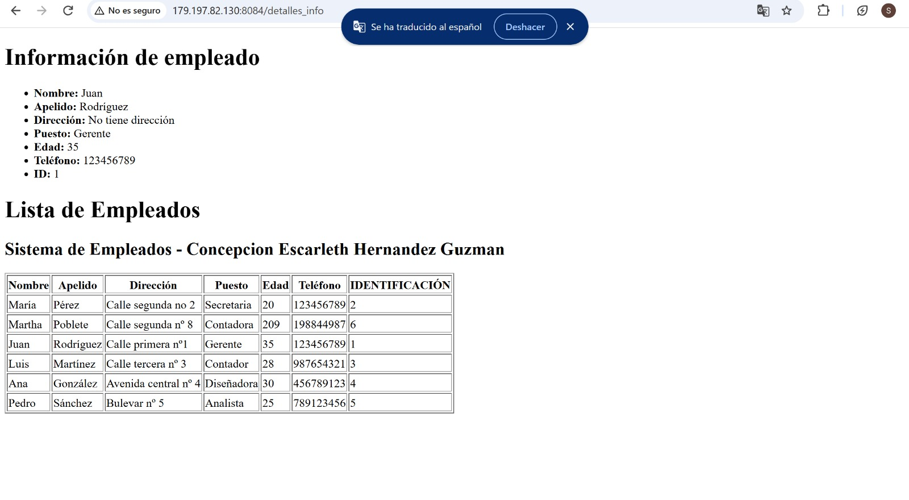
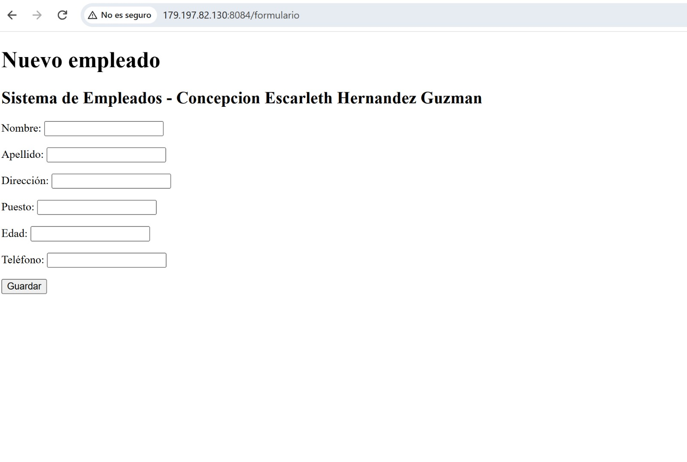
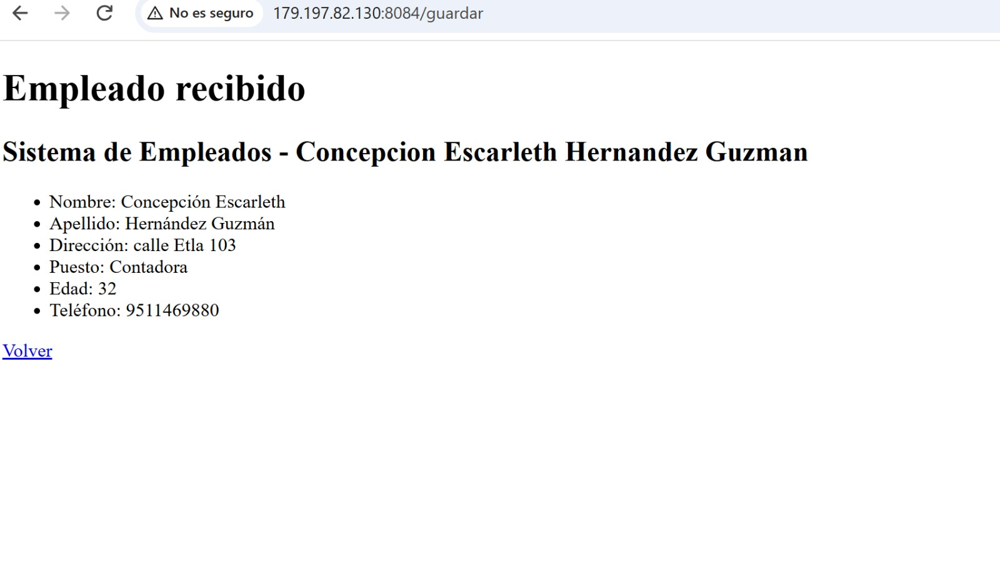
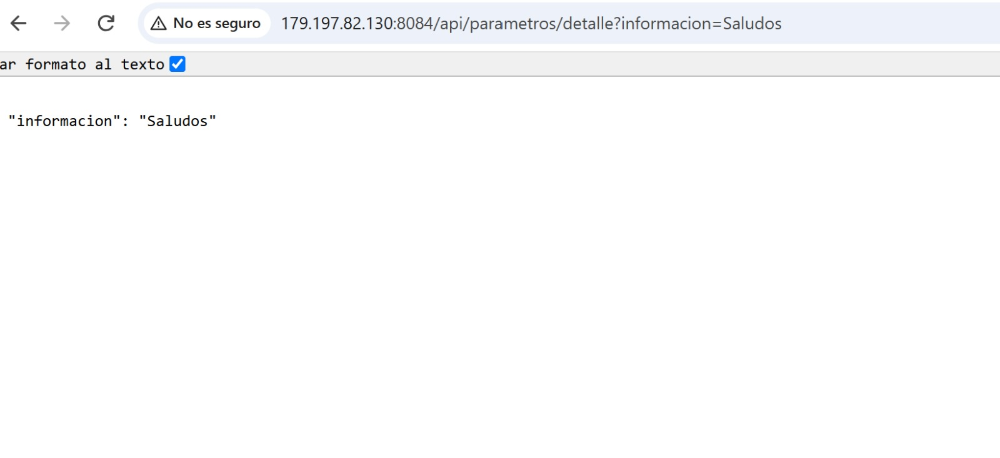
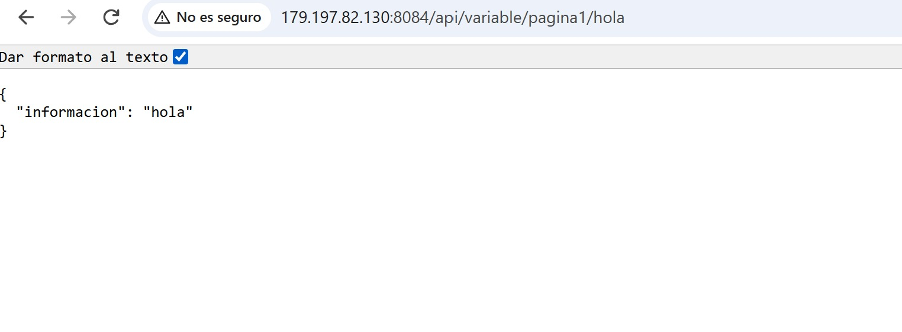
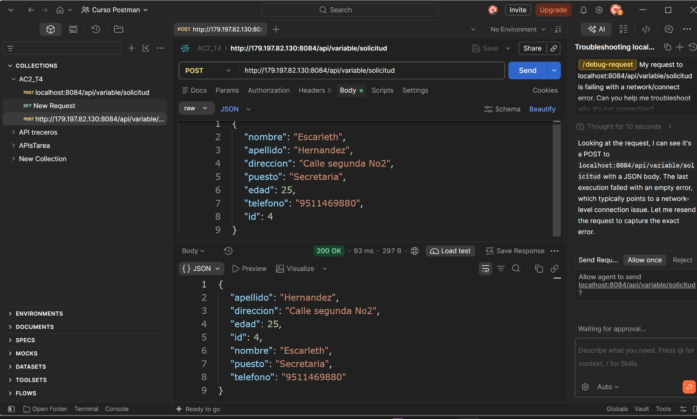
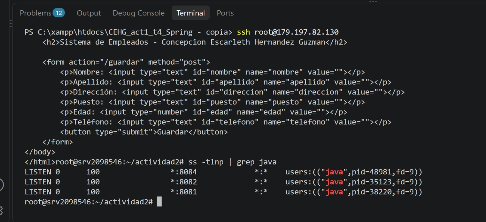

# CEHGact2_t4

**Autora:** Concepción Escarleth Hernández Guzmán

**Actividad:** Act2. Spring MVC y Vistas con Thymeleaf, DTOs y Manejo de Peticiones

## Descripción

Esta actividad es la continuación de mi proyecto de la Actividad 1. Trabajé sobre una copia, así que el proyecto original sigue intacto. Agregué vistas con Thymeleaf, una clase DTO, un formulario, recepción de datos por URL y por ruta, lectura de propiedades externas y un endpoint POST que devuelve JSON. Primero lo probé en mi computadora y después lo desplegué en un VPS, en un puerto distinto al de la Actividad 1.

## Lo que realicé

1. Dupliqué mi proyecto de la Actividad 1 y creé este repositorio independiente.
2. Vi los videos 8 al 17 de la playlist y los seguí en mi computadora.
3. Usé la dependencia `spring-boot-starter-thymeleaf`.
4. Creé la clase `EmpleadoDTO` para representar los datos de un empleado.
5. Hice una vista con la lista de empleados usando `Model` y `th:each`.
6. Hice un formulario que recibe los datos con `@ModelAttribute` y los muestra en una página de resultado.
7. Usé `@RequestParam` para recibir un dato por la URL.
8. Usé `@PathVariable` para recibir un dato dentro de la ruta.
9. Leí propiedades de `application.properties` con `@Value` y mostré una en las vistas.
10. Creé un endpoint POST REST con `@RequestBody` que usa el DTO y lo probé en Postman.
11. Generé el `.jar` con Maven y lo subí con SCP a una carpeta nueva del VPS.
12. Lo ejecuté con `nohup` en el puerto 8084, sin afectar la Actividad 1.

## Tecnologías

- Java 21 (versión instalada en el VPS)
- Spring Boot 4.1.2
- Spring Web
- Thymeleaf
- Spring Boot DevTools
- Maven
- Postman
- Ubuntu en el VPS
- Git y GitHub

## Estructura del proyecto

```
src/main/java/com/informaticonfig/spring/app1/springboot_applications
├── controllers
│   ├── EjemploController.java
│   ├── EjemploRestController.java
│   ├── RequestParamControllers.java
│   ├── PathVariableController.java
│   ├── PerfilController.java
│   ├── ProyectoController.java
│   └── ParametroDTO.java
├── models
│   ├── Empleados.java
│   └── dto
│       ├── ClaseDTO.java
│       └── EmpleadoDTO.java
└── SpringbootApplicationsApplication.java

src/main/resources
├── application.properties
└── templates
    ├── detalles_info.html
    ├── formulario.html
    └── resultado.html
```

## Patrón MVC en mi proyecto

| Parte | Dónde está |
|---|---|
| **Modelo** | `Empleados` y `EmpleadoDTO` (los datos) |
| **Vista** | `detalles_info.html`, `formulario.html` y `resultado.html` |
| **Controlador** | `EjemploController`, que recibe la petición, prepara los datos y elige la vista |

## Requisitos de la actividad y dónde los resolví

| Requisito | Dónde está |
|---|---|
| Lista con `Model` y `th:each` | `/detalles_info` |
| Formulario con `@ModelAttribute` | `/formulario` y `/guardar` |
| `@RequestParam` | `/api/parametros/detalle?informacion=...` |
| `@PathVariable` | `/api/variable/pagina1/{mensaje}` |
| `@Value` mostrado en la vista | `config.nombre`, visible en `/detalles_info` y `/formulario` |
| DTO en la vista y en el POST | `EmpleadoDTO` |
| POST REST con JSON | `/api/variable/solicitud` |

## Endpoints

### Vistas HTML

| Ruta | Descripción |
|---|---|
| `/detalles_info` | Datos de un empleado y tabla con la lista de empleados |
| `/formulario` | Formulario para capturar un empleado |
| `/guardar` (POST) | Recibe el formulario y muestra el resultado |

### Respuestas JSON

| Ruta | Anotación | Descripción |
|---|---|---|
| `/api/detalles_info2` | `@GetMapping` | JSON de ejemplo del video |
| `/api/parametros/detalle?informacion=Saludos` | `@RequestParam` | Devuelve el texto enviado |
| `/api/variable/pagina1/{mensaje}` | `@PathVariable` | Devuelve el mensaje de la ruta |
| `/api/variable/valores` | `@Value` | Muestra los valores de `application.properties` |
| `/api/variable/solicitud` (POST) | `@RequestBody` | Recibe un empleado en JSON y lo devuelve |

Ejemplo del cuerpo que envío en Postman:

```json
{
    "nombre": "Escarleth",
    "apellido": "Hernandez",
    "direccion": "Calle segunda No2",
    "puesto": "Secretaria",
    "edad": 25,
    "telefono": "9511469880",
    "id": 4
}
```

## Propiedades personalizadas

Están en `src/main/resources/application.properties`:

```properties
spring.application.name=springboot-applications
server.port=8084
config.codigo=123456
config.usuario=informaticonfig
config.mensaje=hola a todos
config.valores=saludos, alumnos, de, springboot
config.nombre=Sistema de Empleados - Concepcion Escarleth Hernandez
```

## Capturas de pantalla

### Lista con th:each y @Value


### Formulario con @ModelAttribute


### Resultado del formulario


### Endpoint con @RequestParam


### Endpoint con @PathVariable


### POST probado en Postman (local)


### VPS con ambas actividades corriendo


## Ejecución local

```
.\mvnw.cmd spring-boot:run
```

Después abro `http://localhost:8084/detalles_info` en el navegador.

## Despliegue en el VPS

El proyecto corre en la carpeta `/root/actividad2` del VPS, en el puerto **8084**. La Actividad 1 sigue corriendo en su carpeta y en su puerto original.

```
.\mvnw.cmd clean package -DskipTests
scp target\springboot-applications-0.0.1-SNAPSHOT.jar root@179.197.82.130:/root/actividad2/
cd /root/actividad2
nohup java -jar springboot-applications-0.0.1-SNAPSHOT.jar --server.port=8084 > salida.log 2>&1 &
```

Para comprobar que ambos procesos están activos:

```
ss -tlnp | grep java
```

## Enlaces

| Descripción | Enlace |
|---|---|
| Lista de empleados | http://179.197.82.130:8084/detalles_info |
| Formulario | http://179.197.82.130:8084/formulario |
| @RequestParam | http://179.197.82.130:8084/api/parametros/detalle?informacion=Saludos |
| @PathVariable | http://179.197.82.130:8084/api/variable/pagina1/hola |
| Actividad 1 (sigue activa) | http://179.197.82.130:8081/detalles_info |
